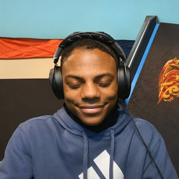

<p align="center">
  
</p>
<h1 align="center">BroPad</h1>
<p align="center"><strong>Your favorite sounds. One key away.</strong></p>
<p align="center">A lightweight, open-source Windows soundboard for your desktop, voice chats and games.</p>
<p align="center">
  <a href="https://github.com/yigitd100/BroPad/releases/download/v1.2.0-preview.1/BroPad.exe"><strong>Download for Windows x64</strong></a>
  · <a href="https://github.com/yigitd100/BroPad/releases">Release notes</a>
  · <a href="README.tr.md">Türkçe</a>
</p>
<p align="center">
  <a href="https://github.com/yigitd100/BroPad/actions/workflows/build.yml"></a>
  · Windows 10 / 11 · English / Türkçe · MIT code license
</p>

**One download. No separate driver download.** Play locally right away, then enable
voice-chat routing inside BroPad when you need it.

> **Preview release:** the app and package checks have passed during development.
> First-time driver installation and restart behavior still need clean-Windows
> testing. Feedback and reproducible bug reports are welcome.

## What makes BroPad useful?

| Feature | What you get |
| --- | --- |
| Global shortcuts | Trigger sounds while your game or another app has focus. |
| Single EXE download | Open BroPad without unpacking a ZIP or finding DLLs. |
| Built-in voice-chat setup | The original signed audio-driver package is included. |
| Local playback | Use your speakers or headphones immediately. |
| Microphone mixing | Send your voice and sound effects together in voice-chat mode. |
| Your own library | Add audio files, rename pads and adjust each sound's volume. |
| English and Turkish | Change language instantly; your choice is remembered. |
| DPI-aware interface | Scales with Windows and keeps controls accessible. |

A Windows soundboard with global shortcuts, English/Turkish UI, microphone mixing
and headphone monitoring. The app opens in English by default and remembers your
language choice.

## Download and use

Download [**BroPad.exe**](https://github.com/yigitd100/BroPad/releases/download/v1.2.0-preview.1/BroPad.exe) from the Releases page. No ZIP extraction,
separate app installation, .NET SDK, account or external audio-driver download is
needed. Windows 10 22H2 / Windows 11 x64 with .NET Framework 4.8 is the supported
target. The app unpacks its bundled runtime into your local application data.

- **On my device:** playback starts automatically on your listening device. Three
  small sample sounds are included on a new library. Click a pad or use its hotkey.
- **Voice chat / games:** choose this mode to route sounds to Discord or a game.
  If setup is needed, click **Enable voice chat**. BroPad includes the original
  signed VB-CABLE package; users do not have to find or download it separately.
  Windows requires administrator approval once to install the audio driver.
  A restart may be required; BroPad never restarts Windows automatically.
- In Discord or your game, choose **CABLE Output** as the microphone. That
  application-specific microphone choice is still necessary. BroPad does not edit
  your Discord configuration or change your Windows default devices.
- Enable **Mix in my microphone** to include your own voice in voice-chat mode.
  Local playback never routes your microphone into your speakers.
- Right-click a pad to rename it, change volume or assign a shortcut.
- **Ctrl + Shift + Space:** stop all clips. An enabled microphone continues.
- **Language → Türkçe:** switch to Turkish; **Dil → English** switches back.

If you skip/cancel voice-chat setup, local sound playback remains available.
Voice-chat mode falls back to local playback with an explicit setup message.

## Included audio component

**VB-CABLE by VB-Audio is donationware. Contributions are welcome.**
Origin: https://www.vb-cable.com/ · Product: https://vb-audio.com/Cable/
Donation / license: https://shop.vb-audio.com/

VB-CABLE remains a separately attributed third-party driver. BroPad bundles its
original archive unchanged and verifies the archive hash, installer hash and
Windows trust signature before requesting elevation. See
[third-party notices](THIRD-PARTY-NOTICES.md) and the vendor's
[distribution terms](https://vb-audio.com/Services/licensing.htm).

## Build on Windows

Run in PowerShell:

```powershell
./build.ps1
./tests/run.ps1
```

Output: `dist/BroPad.exe` and `dist/SHA256SUMS.txt`.
The build uses the .NET Framework compiler included with Windows. Dependencies are
downloaded from nuget.org and VB-Audio's official site at fixed versions, and
checked with SHA-256. Later builds can use `./build.ps1 -Offline` with the cache.

The GitHub Actions workflow builds and uploads an artifact. It does not publish
a GitHub Release automatically. For a release, upload only `BroPad.exe` and
`SHA256SUMS.txt`; keep `app-path.txt` and validation staging files out of the
public binary release.

## How it works

- `src/BroPad.cs`: UI, persisted library, hotkeys and WASAPI playback/mixing.
- `src/VoiceSetup.cs`: voice-chat setup, package verification and vendor installer.
- `packaging/Bootstrap.cs`: single-download launcher. It verifies and extracts an
  embedded package to `%LOCALAPPDATA%\BroPad\runtime\<package hash>` and launches
  the unprivileged application. Cached application files are checked on each run.
- User sounds and preferences live under `%LOCALAPPDATA%\BroPad`, outside the
  versioned runtime. Upgrading does not replace them. Existing KankaPad libraries
  migrate by copying; original files remain.
- WAV, MP3, AIFF; M4A/AAC/WMA depend on Windows codecs. Mono/stereo files only.
- No runtime downloads, telemetry, account system or background auto-updater.

## Validation limits

Automated checks cover default/local fallback behavior, microphone isolation,
localization and persistence, sample copying, DPI layout geometry, archive path
validation, signatures and the final embedded package. They do not install or
uninstall a driver. The single-file launcher and an already installed virtual
cable were checked during development. A clean Windows VM installation, UAC
cancellation, restart and a real Discord/game call are required before calling a
public release fully validated.

The BroPad executables are currently unsigned; the bundled third-party driver is
signed. Windows may show a reputation warning for an unsigned new application.
Public production releases can be signed with the maintainer's own certificate.

## Uninstall

Close BroPad and remove its downloaded EXE. App files are under
`%LOCALAPPDATA%\BroPad`. Keep `sounds` and `library.json` if you want your library.
To remove the shared VB-CABLE driver, open the original vendor installer and use
its removal action, then follow its restart instructions. Do not remove it if
other applications rely on it. BroPad does not uninstall shared drivers itself.

## License

BroPad code and generated sample sounds: MIT. NAudio: MIT. VB-CABLE retains its
vendor license. The supplied photo/logo is excluded from the MIT code license.
See [LICENSE](LICENSE) and [third-party notices](THIRD-PARTY-NOTICES.md).

[Türkçe kullanım](README.tr.md)
